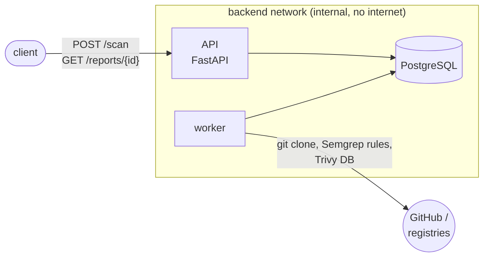

# devsecops-scan-platform

[](https://github.com/Ye2312/devsecops-scan-platform/actions/workflows/ci.yml)
[](https://github.com/Ye2312/devsecops-scan-platform/actions/workflows/security.yml)

A service that scans public GitHub repositories for security problems: SAST with
Semgrep; dependency vulnerabilities, leaked secrets and IaC misconfigurations with Trivy.
Results from both tools are normalized into one data model and served by a REST API.

The scanner processes code it doesn't trust, so most of the work is about doing that safely.
See [Security design](#security-design).

**Stack:** Python 3.12, FastAPI, PostgreSQL, SQLAlchemy + Alembic, Docker Compose,
GitHub Actions, Semgrep, Trivy

## Architecture



1. `POST /scan` validates the URL and queues a scan row.
2. A worker claims the oldest queued scan (`SELECT … FOR UPDATE SKIP LOCKED`, so several workers
   can run without double-processing), shallow-clones the repo into a temp dir, and runs
   Semgrep and `trivy fs`.
3. Findings from both tools are normalized (`tool, category, rule_id, severity, file, line,
   package, versions`) and stored; the scan becomes `done` or `failed` with an error message.
4. `GET /reports/{id}` returns findings most-severe first, with filters by severity and category.

Scans left `running` by a crashed worker are re-queued after a timeout.

## Quick start

```bash
docker compose up --build -d
curl -s -X POST http://127.0.0.1:8000/scan \
  -H 'content-type: application/json' \
  -d '{"repo_url": "https://github.com/Ye2312/attack-emulator"}'


curl -s "http://127.0.0.1:8000/reports/<scan_id>?severity=HIGH"
```

Interactive API docs: http://127.0.0.1:8000/docs. A scan of a small repo takes under a minute;
the first one is slower while Trivy downloads its vulnerability DB.

Example summary for [attack-emulator](https://github.com/Ye2312/attack-emulator), a deliberately
vulnerable Flask app:

```json
{"total": 24, "by_severity": {"HIGH": 3, "MEDIUM": 20, "LOW": 1}, "by_category": {"sast": 15, "sca": 9}}
```

There is also a CLI that scans without the database:

```bash
python -m worker.cli scan --url https://github.com/Ye2312/attack-emulator
python -m worker.cli scan ./some/local/dir --format json
```

## Development

```bash
make install    
make db-up      
make migrate
make test       
make lint       
make api        
make worker
```

## Security design

**Untrusted input: the repository URL.** Only `https://github.com/<owner>/<repo>` is accepted:
no other hosts, schemes, ports or embedded credentials, and the URL is rebuilt from the
validated parts before use. `git` runs with `GIT_ALLOW_PROTOCOL=https`, no terminal prompts,
`--depth 1` and a timeout. This closes SSRF to internal addresses
(`http://169.254.169.254/…` is rejected with 422) and option injection into `git`.

**Untrusted input: the repository content.**
- A scanned repo can ship its own `.semgrepignore` and hide its vulnerable files from SAST.
  The worker deletes every `.semgrepignore` in the checkout before scanning.
- Trivy's output embeds the source lines around each finding. It masks only the matched secret,
  so a neighbouring credential would end up in the database in cleartext. Those code blocks are
  stripped before findings are stored.
- Nothing from the repo is executed: clones don't run hooks, submodules aren't fetched, and
  both scanners are static.

**Containment.** The worker container runs as a non-root user with a read-only root filesystem,
all capabilities dropped and `no-new-privileges`. Clones live on a size-limited tmpfs. Memory
and PID limits are set. Each scanner has a timeout; Semgrep is killed as a whole process
group, because its analysis runs in a grandchild process.

**Network segmentation.** Postgres sits only on an internal network with no route to the
internet. The API and worker are on that network plus an egress network: the API to publish
its port, the worker to reach GitHub and the scanners' rule and vulnerability feeds.

## CI and supply chain

| Workflow | What runs | Blocks the build on |
|---|---|---|
| `ci.yml` | ruff, mypy, Alembic migration + schema drift check, pytest against Postgres | any failure |
| `security.yml` | Semgrep (`p/python`, `p/dockerfile`, `p/github-actions`, `p/secrets`) | high-severity findings |
| | `trivy fs`: dependencies, secrets, IaC | HIGH / CRITICAL |
| | `trivy image` for both images | fixable HIGH / CRITICAL |

All results are also uploaded as SARIF to GitHub code scanning, and the security workflow
reruns weekly, because new CVEs appear without code changes. `tests/fixtures/vulnerable-app` is
intentionally vulnerable and excluded from the gate.

- Third-party actions are pinned to commit SHAs. Trivy is installed at a pinned version with
  its SHA-256 verified (`scripts/install-trivy.sh`), and Semgrep is pinned, so scan results
  are reproducible. Dependabot proposes updates for actions, base images and Python packages.
- Accepted risks live in [`.trivyignore.yaml`](.trivyignore.yaml), each with a reason and an
  expiry date. Once an entry expires, the finding fails the gate again.

## Roadmap

- Kubernetes manifests: NetworkPolicy, `securityContext`, resource limits, a Job for migrations
- Authentication and rate limiting on the API
- SBOM export for scanned repositories
